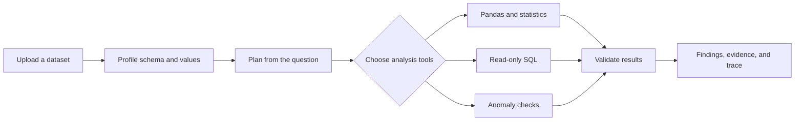

<div align="center">

# ARGUS AI

### Find organizational evidence. Keep the source trail.

An early enterprise knowledge prototype with a local text-document library and source-passage search. A separate legacy workspace still demonstrates structured-data analytics.

[](https://github.com/SamyakAnand/Argus-Ai/actions/workflows/ci.yml)


<br />

[Get started](#-get-started) · [Explore features](#-what-you-can-do) · [Architecture](#-how-it-works) · [API](#-api-at-a-glance) · [Limitations](#-honest-product-boundaries)

</div>

---

> **Project status:** Development preview. ARGUS can index UTF-8 Markdown/text locally and retrieve passages with exact source offsets. Optional answer synthesis is disabled by default and uses the existing configured provider only after explicit opt-in. Citation checks verify passage IDs, not semantic entailment. Not ready for sensitive or multi-tenant workloads.

## ✨ What you can do

| Area | Try it | What happens |
| --- | --- | --- |
| **Knowledge library** | `/documents` | Ingest Markdown/UTF-8 text as local passages; structured datasets are shown separately. |
| **Ask ARGUS** | `/search` | Retrieve source passages and, only when explicitly enabled with a provider, generate structured claims with citation-ID checks. |
| **Analyze · legacy** | `/workspace` | Explore a separate structured-data analytics prototype and its calculation traces. |
| **Follow data lineage** | `/graph` | View detected relationships between structured sources; this is not a document knowledge graph. |
| **Evaluate** | `/evaluation` | Run the small, deterministic fixture evaluation suite. |
| **Review runs** | `/sessions` | Revisit legacy analysis sessions saved in this browser. |

Other areas: [`/overview`](apps/web/src/app/overview/page.tsx), [`/models`](apps/web/src/app/models/page.tsx), and [`/settings`](apps/web/src/app/settings/page.tsx).

### A question, a plan, and inspectable results

The analysis flow profiles the selected dataset, chooses relevant deterministic tools, checks their results, and returns findings with source-column evidence and caveats. Depending on the question, tools can include Pandas analysis, read-only SQL, statistical tests, and anomaly detection.



## 🚀 Get started

### Requirements

- Python 3.11 or newer
- Node.js 20 or newer and npm

For the verified ARGUS knowledge API and web app configuration, use the two-terminal procedure below. The generic API proxy defaults to port 8000, so explicitly configure `BACKEND_URL` to the port where this ARGUS API is running.

### Verified local ARGUS knowledge workflow (PowerShell)

The checked-in Next proxy defaults to port `8000`, which may be owned by another local service. The existing workspace used port `8010` for an older ARGUS API without the knowledge routes. For a clean local run, use a confirmed free port such as `8012`; inspect listeners first and choose another free port if needed. Do not stop an unknown listener.

Terminal 1, from the repository root:

```powershell
py -3 -m venv .venv
.\.venv\Scripts\Activate.ps1
python -m pip install -r apps/api/requirements.txt
$env:ARGUS_KNOWLEDGE_DEV_TOKENS_JSON = '{"local-development":"replace-with-a-long-random-local-token"}'
$env:ARGUS_KNOWLEDGE_DIR = "$PWD/data/argus-knowledge-local"
python -m uvicorn nexus_api.main:app --app-dir apps/api --host 127.0.0.1 --port 8012
```

Terminal 2:

```powershell
cd apps/web
npm ci
$env:BACKEND_URL = "http://127.0.0.1:8012"
npm run dev -- --port 3002
```

Open [localhost:3002/documents](http://localhost:3002/documents) or [localhost:3002/search](http://localhost:3002/search), paste the same local token into the access field, then upload and ask questions. The token map is server configuration; principal names are chosen server-side and are never accepted from request parameters. Use distinct random tokens per local principal. The adapter refuses to run when `VERCEL` is set. It provides no account lifecycle, secure session issuance, identity proofing, key rotation, rate limiting, or production tenant administration.

### Clerk development authentication

ARGUS now supports Clerk sessions for the knowledge API. The Clerk CLI created an accountless, claimable development application and stored its keys in ignored `apps/web/.env.local`; sensitive claim metadata is also kept under ignored `apps/web/.clerk/`. Sign-in and sign-up pages are at `/sign-in` and `/sign-up`. The API loads local keys only outside Vercel, verifies session tokens with Clerk's Python backend SDK, and scopes knowledge rows using the verified user ID. Existing local-token credentials and `local-development` documents remain separate; nothing is automatically reassigned.

For a clean local run, first check that ports `8013` and `3003` are free. In Terminal 1, from the repository root:

```powershell
$env:CLERK_AUTHORIZED_PARTIES = "http://localhost:3003,http://127.0.0.1:3003"
$env:ARGUS_KNOWLEDGE_DIR = "$PWD/data/argus-knowledge-clerk-local"
py -3 -m uvicorn nexus_api.main:app --app-dir apps/api --host 127.0.0.1 --port 8013
```

In Terminal 2:

```powershell
cd apps/web
$env:BACKEND_URL = "http://127.0.0.1:8013"
npm run dev -- --port 3003
```

Open [localhost:3003/sign-up](http://localhost:3003/sign-up) to create a development user, then use the knowledge library and evidence search. If you use another frontend origin, add it to the API's comma-separated `CLERK_AUTHORIZED_PARTIES`. To claim the temporary Clerk application for dashboard management, run `npx -y clerk@latest auth login` yourself. Do not copy development keys into source files, commit them, or reuse them for production. Vercel production credentials and allowed origins still need to be configured; durable multi-user storage and the legacy structured-data API's authorization are not covered by this integration.

For PowerShell port ownership checks, run `Get-NetTCPConnection -State Listen | Where-Object LocalPort -in 3000,3001,8000,8010,8012 | Select-Object LocalPort,OwningProcess`; resolve each PID command line before acting on it.

<details>
<summary><strong>Choosing another free API port</strong></summary>

If `8012` is occupied, first inspect the listener and choose another free port. Start the API and point Next at that same port:

```powershell
python -m uvicorn nexus_api.main:app --app-dir apps/api --host 127.0.0.1 --port 8013
```

Then set the web proxy before starting Next.js:

```powershell
$env:BACKEND_URL = "http://127.0.0.1:8013"
npm run dev -- --port 3003
```

</details>

<details>
<summary><strong>Docker Compose</strong></summary>

```powershell
Copy-Item .env.example .env
docker compose up --build
```

Compose starts the web app, API, PostgreSQL, and Redis. The current API data and run registries still use local file/SQLite storage; provisioning PostgreSQL and Redis does not mean the application is persisting its core records to them.

</details>

## 🧭 How it works

| Layer | Implementation |
| --- | --- |
| Interface | Next.js App Router, React, TypeScript, and Recharts |
| API | FastAPI with Pydantic request and response models |
| Analysis | Pandas, NumPy, SciPy, scikit-learn, and a read-only SQL analysis path |
| Local storage | Files under `data/` and SQLite for development |
| Evaluation | Small deterministic tool-routing and column-metadata fixtures |

Start with the [web app](apps/web/src/app), [analysis engine](apps/api/nexus_api/analysis.py), [API routes](apps/api/nexus_api/main.py), or [architecture notes](docs/ARCHITECTURE.md).

## 🔌 API at a glance

<details>
<summary><strong>Expand the endpoint list</strong></summary>

| Method | Endpoint | Purpose |
| --- | --- | --- |
| `GET` | `/health` | API and configured capability status |
| `POST` | `/knowledge/documents` | Store a Markdown or UTF-8 text knowledge source |
| `GET` | `/knowledge/documents` | List ingested knowledge sources |
| `GET` | `/knowledge/search` | Retrieve lexical passages without model synthesis |
| `POST` | `/knowledge/ask` | Retrieve bounded evidence and optionally synthesize citation-linked claims |
| `GET` | `/knowledge/evaluation` | Measure the checked-in synthetic v1 retrieval fixture |
| `POST` | `/datasets/upload` | Upload CSV, JSON, or XLSX |
| `GET` | `/datasets` | List datasets |
| `GET` | `/datasets/{id}` | Dataset profile and schema |
| `GET` | `/datasets/{id}/preview` | Preview rows |
| `GET` | `/datasets/{id}/export` | Export as CSV or XLSX |
| `GET` | `/datasets/{id}/cleaning` | Inspect cleaning suggestions |
| `POST` | `/datasets/{id}/cleaning/preview` | Preview cleaning operations |
| `POST` | `/datasets/{id}/cleaning/apply` | Create a cleaned copy |
| `POST` | `/analysis` | Analyze a question against a dataset |
| `GET` | `/analysis/{id}/trace` | Inspect the actual run trace |
| `GET` | `/analysis/{id}/insights` | Read findings and evidence |
| `POST` | `/sql/query` | Run a read-only query on the active dataset |
| `POST` | `/evaluations/run` | Run the deterministic fixture evaluation |

OpenAPI UI: [`/docs`](http://127.0.0.1:8012/docs) when using the verified local API port (8012).

</details>

## 🧪 Checks

The repository CI workflow runs the API test suite and the web typecheck/production build on pushes and pull requests. To run the checks locally:

```powershell
pytest -c apps/api/pytest.ini apps/api/tests
```

```powershell
cd apps/web
npm ci
npm run typecheck
npm run build
```

The in-app evaluation is a small deterministic fixture—not a benchmark of semantic or vector retrieval. `argus-knowledge-v1` has three positive cases with one expected passage each; all three rank first. The abstention case returns no passage. Macro Precision@3 is 0.250 because each positive case contributes 1/3 and abstention contributes zero: (1/3 + 1/3 + 1/3 + 0)/4. Recall@3 is 1.000 because all three relevant IDs were retrieved (3/3). MRR@3 is 0.750 because the three positive cases contribute 1 each and the abstention case contributes zero (3/4). These ID-based labels do not establish semantic relevance. The endpoint now returns per-case expected IDs, ranking and metric denominator definitions.

## 🛡️ Honest product boundaries

<details>
<summary><strong>Read the current limitations</strong></summary>

- The knowledge library accepts Markdown and UTF-8 text, up to 5 MiB. PDF, DOCX, OCR, and image extraction are not implemented. Structured datasets remain a separate legacy feature.
- Retrieval uses simple lexical term-frequency ranking and returns actual stored passages. There are no embeddings, semantic retrieval, BM25, RRF, or semantic citation entailment validation. Model synthesis is opt-in, can incur provider cost, and is not independently verified.
- The document SQLite store is local and ephemeral on Vercel; there is no remote durable document store or delete/version lifecycle. Knowledge routes have a local-only bearer adapter; production identity and tenant isolation are not available.
- Sessions are stored in the current browser; they are not shared account history.
- The knowledge API verifies Clerk sessions and scopes documents/passages by the verified user ID; an explicit local bearer adapter remains for development. Production Clerk credentials/origins and durable tenant-scoped storage have not been configured or audited. Do not upload confidential or sensitive information.
- The local SQL analysis path is read-only, but the broader connector and deployment surface has not had a security review.
- PostgreSQL/pgvector and Redis appear in the deployment shape, but core API storage is not yet durably backed by them.
- Optional model-provider settings do not make provider output independently verified. Keep credentials server-side and configure only providers you intend to use.

See the [threat model](docs/THREAT_MODEL.md) and [evaluation plan](docs/EVALUATION_PLAN.md) for design notes and open work.

</details>

## 🗺️ Project map

```text
apps/
├── api/       FastAPI service, analysis engine, tests, and evaluation fixtures
└── web/       Next.js application and ARGUS interface
data/          Synthetic demo sales dataset
database/      PostgreSQL schema draft
docs/          Architecture, API, security, and evaluation notes
docker/        API and web container definitions
```

## 🤝 Contributing

Issues and pull requests are welcome. Please include the exact steps to reproduce a bug, and avoid attaching private datasets, credentials, or personal information.

<div align="center">

**ARGUS AI · inspectable analysis, built one step at a time**

[Back to top](#argus-ai)

</div>
