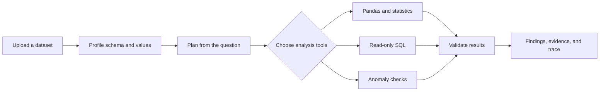

<div align="center">

# ARGUS AI

### Turn business data into answers you can inspect.

An interactive analytics prototype for exploring tabular data, asking questions in plain language, and tracing findings back to calculations and source columns.

[](https://github.com/SamyakAnand/Argus-Ai/actions/workflows/ci.yml)


<br />

[Get started](#-get-started) · [Explore features](#-what-you-can-do) · [Architecture](#-how-it-works) · [API](#-api-at-a-glance) · [Limitations](#-honest-product-boundaries)

</div>

---

> **Project status:** Development preview. The ARGUS interface currently wraps a tabular data analysis engine. It is not a document RAG platform and is not ready for sensitive or multi-tenant workloads.

## ✨ What you can do

| Area | Try it | What happens |
| --- | --- | --- |
| **Analyze** | `/workspace` | Ask a question about a dataset and inspect the selected analysis steps, results, and evidence. |
| **Explore data** | `/documents` | Upload and inspect CSV, JSON, or XLSX datasets, including their schema and data quality profile. |
| **Search** | `/search` | Submit a question to the current analysis engine. |
| **Follow lineage** | `/graph` | View detected source relationships and data lineage. |
| **Evaluate** | `/evaluation` | Run the small, deterministic fixture evaluation suite. |
| **Review runs** | `/sessions` | Revisit analysis sessions saved in this browser. |

Other areas: [`/overview`](apps/web/src/app/overview/page.tsx), [`/models`](apps/web/src/app/models/page.tsx), and [`/settings`](apps/web/src/app/settings/page.tsx).

### A question, a plan, and inspectable results

The analysis flow profiles the selected dataset, chooses relevant deterministic tools, checks their results, and returns findings with source-column evidence and caveats. Depending on the question, tools can include Pandas analysis, read-only SQL, statistical tests, and anomaly detection.



## 🚀 Get started

### Requirements

- Python 3.11 or newer
- Node.js 20 or newer and npm

### 1. Start the API

From the repository root:

```powershell
python -m venv .venv
.\.venv\Scripts\Activate.ps1
python -m pip install -r apps/api/requirements.txt
Copy-Item .env.example .env
uvicorn nexus_api.main:app --app-dir apps/api --reload --port 8000
```

If your Windows Python launcher is `py`, replace `python` with `py -3` in the first three commands. The API and interactive docs will be available at [localhost:8000](http://localhost:8000) and [localhost:8000/docs](http://localhost:8000/docs).

### 2. Start the web app

In a second terminal:

```powershell
cd apps/web
npm ci
npm run dev
```

Open [localhost:3000](http://localhost:3000).

<details>
<summary><strong>Using a different API port</strong></summary>

If port `8000` is occupied, start the API on `8010`:

```powershell
uvicorn nexus_api.main:app --app-dir apps/api --reload --port 8010
```

Then set the web proxy before starting Next.js:

```powershell
$env:BACKEND_URL = "http://127.0.0.1:8010"
npm run dev
```

</details>

<details>
<summary><strong>Docker Compose</strong></summary>

```powershell
Copy-Item .env.example .env
docker compose up --build
```

Compose starts the web app, API, PostgreSQL, and Redis. The current API data and run registries still use local file/SQLite storage; provisioning PostgreSQL and Redis does not mean the application is persisting its core records to them.

</details>

## 🧭 How it works

| Layer | Implementation |
| --- | --- |
| Interface | Next.js App Router, React, TypeScript, and Recharts |
| API | FastAPI with Pydantic request and response models |
| Analysis | Pandas, NumPy, SciPy, scikit-learn, and a read-only SQL analysis path |
| Local storage | Files under `data/` and SQLite for development |
| Evaluation | Small deterministic tool-routing and column-metadata fixtures |

Start with the [web app](apps/web/src/app), [analysis engine](apps/api/nexus_api/analysis.py), [API routes](apps/api/nexus_api/main.py), or [architecture notes](docs/ARCHITECTURE.md).

## 🔌 API at a glance

<details>
<summary><strong>Expand the endpoint list</strong></summary>

| Method | Endpoint | Purpose |
| --- | --- | --- |
| `GET` | `/health` | API and configured capability status |
| `POST` | `/datasets/upload` | Upload CSV, JSON, or XLSX |
| `GET` | `/datasets` | List datasets |
| `GET` | `/datasets/{id}` | Dataset profile and schema |
| `GET` | `/datasets/{id}/preview` | Preview rows |
| `GET` | `/datasets/{id}/export` | Export as CSV or XLSX |
| `GET` | `/datasets/{id}/cleaning` | Inspect cleaning suggestions |
| `POST` | `/datasets/{id}/cleaning/preview` | Preview cleaning operations |
| `POST` | `/datasets/{id}/cleaning/apply` | Create a cleaned copy |
| `POST` | `/analysis` | Analyze a question against a dataset |
| `GET` | `/analysis/{id}/trace` | Inspect the actual run trace |
| `GET` | `/analysis/{id}/insights` | Read findings and evidence |
| `POST` | `/sql/query` | Run a read-only query on the active dataset |
| `POST` | `/evaluations/run` | Run the deterministic fixture evaluation |

OpenAPI UI: [`/docs`](http://localhost:8000/docs) when the API is running.

</details>

## 🧪 Checks

The repository CI workflow runs the API test suite and the web typecheck/production build on pushes and pull requests. To run the checks locally:

```powershell
pytest -c apps/api/pytest.ini apps/api/tests
```

```powershell
cd apps/web
npm ci
npm run typecheck
npm run build
```

The in-app evaluation is a small deterministic fixture—not a benchmark of semantic or vector retrieval. It reports tool-selection and metadata-ranking measurements; it does not establish answer quality for arbitrary business data.

## 🛡️ Honest product boundaries

<details>
<summary><strong>Read the current limitations</strong></summary>

- Inputs are tabular files: CSV, JSON, and XLSX. PDF, OCR, image, and general document ingestion are not implemented.
- Search runs the current analysis flow. There is no vector database, BM25 index, hybrid retrieval, or citation-validated document RAG pipeline.
- Sessions are stored in the current browser; they are not shared account history.
- Authentication, authorization, and tenant isolation are not implemented. Do not upload confidential or sensitive information.
- The local SQL analysis path is read-only, but the broader connector and deployment surface has not had a security review.
- PostgreSQL/pgvector and Redis appear in the deployment shape, but core API storage is not yet durably backed by them.
- Optional model-provider settings do not make provider output independently verified. Keep credentials server-side and configure only providers you intend to use.

See the [threat model](docs/THREAT_MODEL.md) and [evaluation plan](docs/EVALUATION_PLAN.md) for design notes and open work.

</details>

## 🗺️ Project map

```text
apps/
├── api/       FastAPI service, analysis engine, tests, and evaluation fixtures
└── web/       Next.js application and ARGUS interface
data/          Synthetic demo sales dataset
database/      PostgreSQL schema draft
docs/          Architecture, API, security, and evaluation notes
docker/        API and web container definitions
```

## 🤝 Contributing

Issues and pull requests are welcome. Please include the exact steps to reproduce a bug, and avoid attaching private datasets, credentials, or personal information.

<div align="center">

**ARGUS AI · inspectable analysis, built one step at a time**

[Back to top](#argus-ai)

</div>
