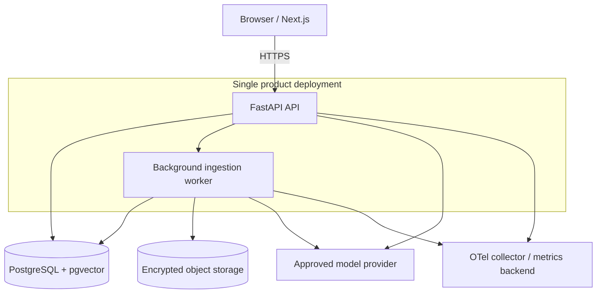

# Architecture Overview

This document describes the proposed target for the Nexus Intelligence Engine. It does not imply that the present Nexus checkout already has RAG, tenant isolation, or multimodal ingestion; see [the audit](PROJECT_AUDIT.md).

## Runtime deployment

## Trust boundaries

- Browser to API: untrusted input; authentication, CSRF/CORS policy, request limits and authorization apply.
- API/worker to database/object store: private service identity, least privilege, tenant-scoped keys and encryption.
- Worker to parser: hostile file boundary; isolate CPU, memory, filesystem and network.
- API/worker to provider: approved egress only; minimize transmitted evidence and redact credentials.
- Retrieved chunks to model: untrusted content, never instructions or tool authorization.

## Data lifecycle

`uploaded → quarantined → queued → parsing → indexing → ready | partial | failed → deleting → deleted`

Each document version records content digest, parser/pipeline version and retention deadline. Delete operations remove object versions, chunks, embeddings, lexical entries, cache entries and derived artifacts, with auditable completion status.

## Operational boundaries

The first production shape is a modular FastAPI service, a separate worker process, PostgreSQL/pgvector, and object storage. Redis is optional for queue/cache coordination only when a concrete need is demonstrated; PostgreSQL-backed queue can be used initially. Existing Docker Compose is a development topology, not evidence of production readiness. Public Vercel file storage and in-memory dataframes are not suitable for durable shared document processing.

## Key decisions

See [ADR-0001](ADR/0001-initial-architecture.md): modular monolith + worker, PostgreSQL/pgvector, hybrid retrieval with RRF, explicit provider capabilities, and a security-first rollout.
