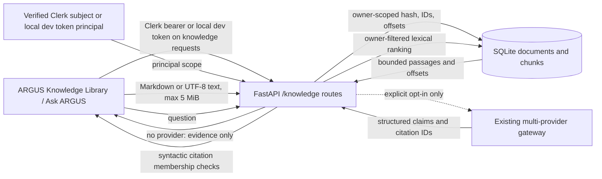

# ARGUS AI architecture

ARGUS AI is intended to answer organizational questions from source documents and help people inspect evidence before making decisions. NEXUS is a separate structured-data analyst. The legacy ARGUS `/workspace` still fronts the NEXUS-derived tabular analytics API and must be treated as a separate prototype surface until retired or replaced.

## Current verified local knowledge slice

The schema is created idempotently in `nexus_api/knowledge.py`; older tables receive an `owner_id` migration whose legacy rows belong to `local-development`. Documents retain original text in SQLite; chunks retain character offsets and deterministic IDs. Upload deduplicates on SHA-256 of principal plus content, so equal content under different principals receives distinct identities. The store defaults to `data/argus-knowledge` locally and `/tmp/argus-knowledge` on Vercel; set `ARGUS_KNOWLEDGE_DIR` to override it. Retrieval scores each chunk by normalized capped lexical term frequency and applies a minimum threshold; this is a simple baseline, not BM25 or semantic similarity. Passage count and model context character limits are bounded by `ARGUS_KNOWLEDGE_MAX_PASSAGES` (default 8, maximum 20) and `ARGUS_KNOWLEDGE_CONTEXT_CHARS` (default 9,000, maximum 24,000).

Knowledge document, search, ask, and evaluation routes derive `owner_id` from the verified principal. Clerk setup uses `@clerk/nextjs` in the frontend and the official `clerk-backend-api` verifier in FastAPI. The browser obtains a short-lived Clerk session token with `useAuth().getToken()` and sends it only to `/knowledge/*`; the checked-in local Next rewrite or Vercel service rewrite forwards the bearer token to FastAPI. The API verifies the session and uses its verified `sub` as the principal; request-supplied owner or tenant IDs are ignored. Local development keys written by Clerk CLI are stored in ignored `apps/web/.env.local`, which the API loads only outside Vercel; the claim metadata in ignored `apps/web/.clerk/` is sensitive and must also stay out of source control. The API accepts `CLERK_AUTHORIZED_PARTIES` as a comma-separated origin allowlist; local defaults cover `localhost` and `127.0.0.1` on ports 3000 and 3002, while Vercel requires an explicit production allowlist. The accountless CLI app is a temporary development instance and remains unclaimed until the owner runs `npx -y clerk@latest auth login`.

The previous `ARGUS_KNOWLEDGE_DEV_TOKENS_JSON` adapter remains available only outside Vercel for local development and accepts server-configured principals. Clerk is preferred when the token is not an explicitly configured local token. Existing SQLite records remain owned by `local-development`; there is no automatic transfer to a Clerk user. Automated tests cover verified-subject scoping, cross-user document visibility, invalid sessions, and local-token fail-closed behavior on Vercel. These controls cover the current knowledge routes only. The legacy structured-data API remains outside Clerk authorization; production account lifecycle, secure key management, token rotation/revocation operations, audit events, rate limits, durable storage, and full service-level tenant isolation are not implemented.

`POST /knowledge/ask` returns a structured status and evidence. Answer generation requires `ARGUS_KNOWLEDGE_GENERATION_ENABLED=true`; it is false by default. When disabled or no provider is configured, ARGUS returns evidence without a generated answer. Enabling generation sends only the bounded question and retrieved passages through the existing provider gateway and can incur provider costs; no provider calls are made by default. The system message explicitly treats passages as untrusted data and tells the model to ignore embedded instructions. This prompt defense is not a hard sandbox.

Generated supported facts, inferences, and conflicts must cite one or more IDs in the current retrieval result. `validate_citations` rejects missing, malformed, or out-of-result-set IDs. This is syntactic reference validation only: it does not establish semantic entailment, factual accuracy, or a contradiction. Claims rejected by the validator are omitted and rejection reasons are returned. The UI renders claims alongside navigable excerpts and makes this limitation visible.

`GET /knowledge/evaluation` runs the checked-in four-case `argus-knowledge-v1` synthetic fixture against the same lexical score function and citation membership validator. All three expected passages rank first; the unsupported question retrieves none. Recall@3 is 3/3 = 1.000. Macro Precision@3 is (1/3 + 1/3 + 1/3 + 0)/4 = 0.250 because the three relevant results occupy one of three slots per positive case and the abstention case contributes zero. MRR@3 is (1 + 1 + 1 + 0)/4 = 0.750 because the abstention case contributes zero to the mean. The endpoint returns ranking IDs and denominator definitions. Metrics are reproducible for this fixture, not a representative benchmark, and ID membership does not establish semantic relevance. Citation protocol metrics test reference acceptance/rejection only, never semantic support.

## Trust and persistence limits

Uploaded text is treated as inert input and never executed. It is sent to the model only when generation is explicitly enabled and a provider exists. Upload size and extension are allowlisted, UTF-8 decoding is strict, and search results are excerpts from stored content. Provider exception logs now omit exception text to avoid leaking request URLs that could contain credentials; API responses expose provider failures without raw provider errors. Clerk-backed identity is implemented for the knowledge API, but this is an integration foundation rather than a complete production security program. There is no account provisioning policy, production-key setup in Vercel, key rotation/revocation process, encryption policy, deletion route, rate limiting, parser process isolation, durable external object store, or persistent audit trail. SQLite/filesystem state remains local and ephemeral on Vercel. Do not use for sensitive data.

The legacy dataset API, model provider, connector, and database paths remain separate from the knowledge store. In particular, `DATABASE_URL`/pgvector does not currently back document retrieval. Do not infer RAG from configured model providers or DDL.

## Target direction (not yet implemented)

Still needed before enterprise claims: secure durable storage/identity boundary, safe PDF/DOCX parsers with provenance, versioned chunks, lexical plus dense retrieval with access filters and rank fusion, semantic citation entailment/reviewer checks, explicit bounded tool registry, investigations and decision briefs, and a representative human-reviewed evaluation set. All integrations require working code and measured tests before product claims.
