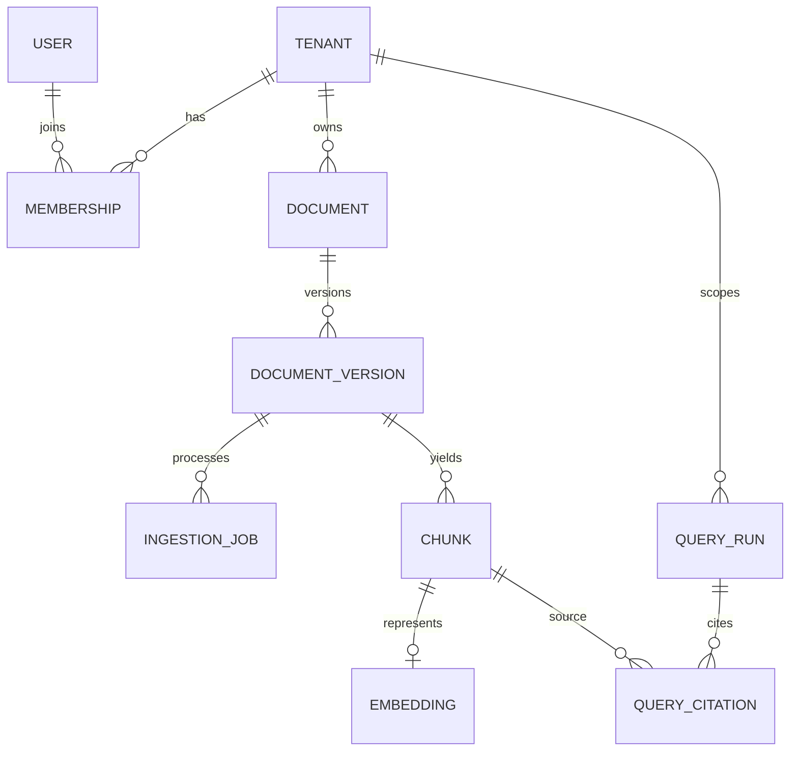

# Database Design

**Status:** Proposed target schema. It is not the current schema. Current ORM/DDL differences are a blocker documented in [PROJECT_AUDIT.md](PROJECT_AUDIT.md).

## Entity relationships

## Core tables

| Table | Important columns and constraints |
|---|---|
| `tenants` | UUID PK, `name`, `created_at`, status. |
| `users` | UUID PK, identity-provider subject unique; do not store passwords in Nexus. |
| `memberships` | `(tenant_id,user_id)` PK, role enum, active flag. |
| `documents` | UUID PK, `tenant_id`, display name, current version, owner, created/updated; unique `(tenant_id,id)`. |
| `document_versions` | UUID PK, tenant/document FK, content SHA-256, object key, media type, byte size, parser/pipeline version, state, retention deadline; unique `(tenant_id,content_sha256,pipeline_version)` when dedupe scope permits. |
| `ingestion_jobs` | UUID PK, tenant/version FK, state, attempt, lease, next retry, sanitized error code, timestamps; unique version+pipeline job. |
| `chunks` | UUID PK, tenant/version FK, ordinal, modality, text/content reference, page/region/bbox/table coordinates, source offsets, parser confidence, content hash; unique `(version_id,ordinal)`. |
| `chunk_embeddings` | chunk FK, embedding model/version, dimensions, vector, created_at; partition or separate table per dimension/model family if required. |
| `query_runs` | UUID PK, tenant/user, query digest, model/index/prompt versions, lane statuses, latency, token/cost estimates, validation status. Avoid retaining raw query unless product policy requires it. |
| `query_citations` | run/chunk FKs, rank per lane, RRF score, final rank, cited flag; enforce tenant equality in repository/RLS policy. |
| `evaluation_cases` / `evaluation_runs` / `evaluation_results` | Versioned case IDs, gold relevant chunk IDs, metrics and measured run config. Dataset content remains synthetic/public unless licensed. |

## Isolation and indexing

Every customer-owned row carries `tenant_id`. Enable PostgreSQL row-level security with deny-by-default policies based on transaction-local authenticated tenant context; repository queries still include explicit tenant predicates. Use composite foreign keys where practical to prevent cross-tenant references. Do not use caller-supplied tenant IDs as authority.

Create B-tree indexes on tenant/state/time and document/version foreign keys. Use a pgvector HNSW cosine index when measured corpus size warrants it; filter by tenant and access scope before returning candidates. Store modality and provenance as typed columns plus bounded JSONB metadata. For lexical search, use a versioned `tsvector` with language config and GIN index, or document an alternative based on measured requirements.

## Migrations and rollback

Use versioned forward-only migrations; production startup must not call `create_all` or silently switch database engines. Apply additive schema changes first, dual-read/write only when necessary, backfill in bounded resumable batches, verify counts/checksums, then switch reads. Rollback uses an application rollback and compensating migration; destructive column/index/data changes wait through a compatibility window. Back up before extension/index or retention changes and rehearse restore. Initial migration should reconcile the existing `database/init.sql` and SQLAlchemy definitions before enabling persistence.

## Retention and deletion

Deletion is an explicit state machine and removes vectors, lexical terms, source references, object versions and cached retrieval results. Preserve minimal audit metadata only for the documented legal/operational retention period. Do not log chunk text, access tokens, connection strings or raw provider request bodies.
