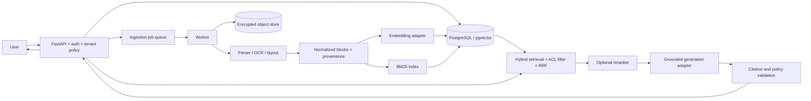
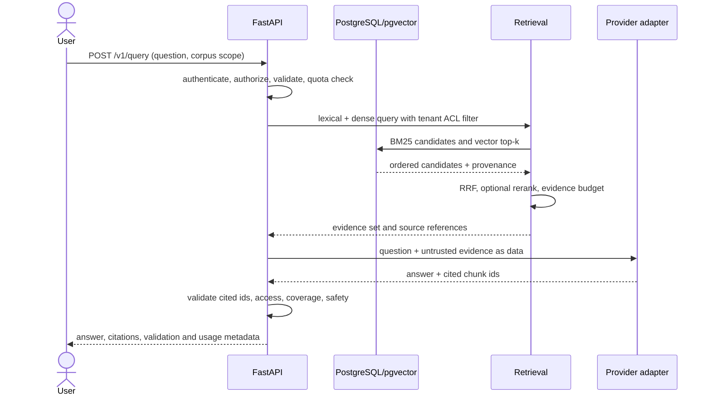

# High-Level Design — Nexus Intelligence Engine

**Status:** Proposed target architecture; not a description of currently implemented production behavior. See [PROJECT_AUDIT.md](PROJECT_AUDIT.md).

## Goals

One modular FastAPI application and background worker process provide governed ingestion and evidence-grounded retrieval over textual, tabular, and visual source material. PostgreSQL/pgvector is the durable control plane and vector store; object storage holds originals and derived artifacts. Retrieval combines lexical BM25 and dense similarity, fuses ranks with Reciprocal Rank Fusion, and may rerank candidates. Models are replaceable adapters; no model may perform arithmetic that deterministic tools can verify.

## Component boundaries

| Component | Responsibility |
|---|---|
| Web client | Upload/search, document and job status, citations and feedback; never holds provider secrets. |
| FastAPI API | Authn/authz, tenant scope, input validation, quotas, job creation, retrieval/query orchestration and response contract. |
| Ingestion worker | Idempotent job lifecycle, safe parsing, OCR/layout extraction, normalization, chunking, embedding and indexing. |
| PostgreSQL + pgvector | Tenants, users, documents/versions, chunks/provenance, job state, evaluations and vector index; row-level security as defense in depth. |
| Object store | Encrypted originals, page images and parser artifacts with tenant-scoped keys and retention policy. |
| Retrieval package | BM25 + dense search, access filtering, RRF, optional cross-encoder and evidence packing. |
| Provider adapters | Capability-declared embedding/generation calls, bounded retries, timeout/circuit state and usage metadata. |
| Telemetry | OpenTelemetry-compatible traces, metrics and structured redacted logs; no raw document content or secrets. |

## Main data flow

## Query sequence

## Reliability and security

Reject unauthenticated requests; apply tenant filters before and after retrieval; validate object ownership on every document/chunk route. Uploads use byte, format, decompression, page, pixel and processing-time ceilings. Parsing occurs outside the API process with restricted filesystem/network access. Jobs are idempotent on tenant + content digest + pipeline version. Retries use exponential backoff with jitter and bounded attempts. Circuit breakers open on sustained provider failures; a fallback is enabled only when the alternative model is explicitly configured, capability-compatible, and policy-approved. Retrieved content is untrusted evidence and cannot change system policy or authorize tools.

## Scaling assumptions and trade-offs

Start as a modular monolith with a separately scaled worker, PostgreSQL and object storage. Do not adopt microservices/Kubernetes until measured contention or independent scaling requires it. Initial retrieval uses exact PostgreSQL filters and pgvector HNSW; BM25 uses PostgreSQL full-text or a measured equivalent. Keep chunk text in database for ACL/provenance simplicity until corpus size requires a dedicated search system. Dense embedding dimensions/model are versioned per index and never silently mixed.
